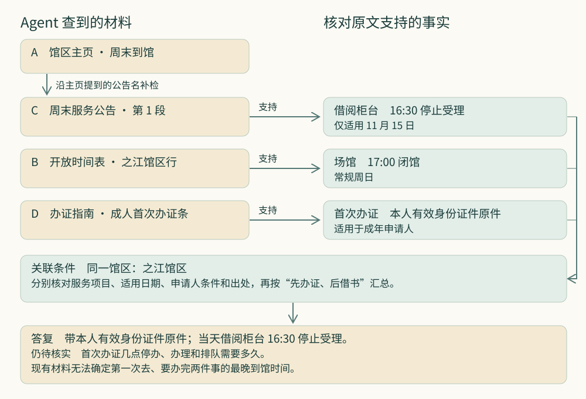
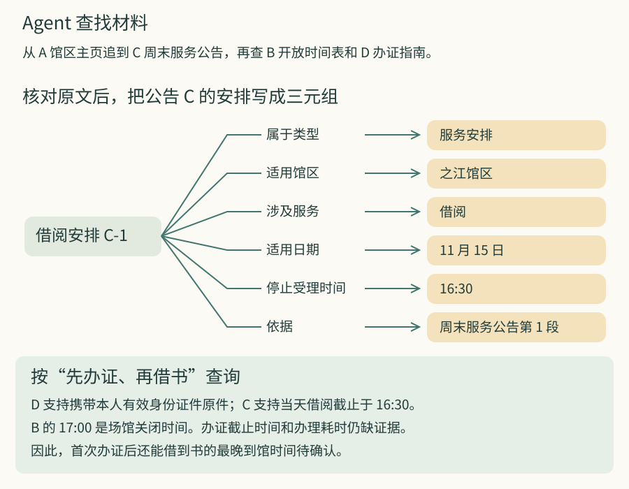

# 第 0 章 · 课程说明

假设图书馆的时间表写着“周日 17:00 闭馆”，另一份公告写着“11 月 15 日，借阅柜台 16:30 停止受理”。那天如果你 16:40 到馆，馆门还开着，借阅柜台却已经停止受理了。假如你把两个时间都填进表格的“开放时间”一栏，下周再翻出来，还能看出 16:30 是哪一天、哪项服务的截止时间吗？

*图 1　为本课编写的模拟公告。你能从中查到当天的借阅截止时间。*

我想和你一起做的，是把手里的资料整理成一个能查、能核对、也能更新的知识库。这是一个知识工程问题。这门课会用到**本体（Ontology）**。建立本体时，我们要说清楚一个领域里有哪些概念，各指什么，彼此有什么关系。拿图书馆来说，一个馆区可以提供多项服务。把这层关系写清楚，以后登记时间时，就知道还要注明是哪项服务的时间。

## 你可以怎样用这门课？

- 如果你正在学计算机工程，可以从一个小练习开始：把公告整理成几条记录，写一条查询，看看你设计的字段能不能分清“闭馆”和“停止借阅”。
- 如果你是软件工程从业者或程序员，正在为企业搭建知识库，可以拿一份工作中常用的文档做练习。请同事根据你在答案里给的出处，找出原文中的那句话。如果这句话后来更正了，你们能找出哪些记录需要更新吗？
- 如果你是架构师，可以带着一个设计问题往下读：哪些需求用现有检索就能满足，哪些值得投入建模？做选择时，既要看谁能省下查资料的时间，也要看以后由谁维护这些记录。

## 从“帮我查一下”到“以后帮我更新”

你可以把一份公告贴进对话框，请语言模型找出里面的日期。手头还没有公告时，你也可以请 **Agent（智能体）** 自己搜索公告，打开原文，发现缺少办证信息时再去查指南。Agent 通过运行环境调用搜索工具、读取文件、保存进度。这样的环境常称为 **Harness**。等新公告发布时，Agent 可以调出上次保存的记录，接着处理。[Agent 开发说明](https://www.anthropic.com/engineering/building-effective-agents) · [长期任务中的 Harness 设计](https://www.anthropic.com/engineering/effective-harnesses-for-long-running-agents)

假如你接着说“以后有新公告，也帮我更新一下”，系统就得学会判断该改哪条记录。下一份公告来了，它要知道该改哪个馆区的哪项服务，还要知道旧记录在哪些日子依然有效。

## 找到了公告，为什么还需要建模？

系统可以先根据你的问题查找相关材料，再把找到的原文连同问题一起交给语言模型，让它依据原文作答。这种做法叫**检索增强生成（RAG）**。如果你只想知道 11 月 15 日几点停止借书，找到开头那份虚构的教学公告，就足以回答“16:30”。假如系统一直答“17:00”，先查查它有没有收录那份公告，搜索时有没有找到它。

第一章会用同一批材料比较三种查法：用 RAG 找相关段落，用 SAG2 根据已经找到的线索继续查，以及用 GraphRAG 沿资料中提到的对象和关系寻找证据。[RAG 原始论文](https://arxiv.org/abs/2005.11401) · [SAG2 原始论文](https://arxiv.org/abs/2610.22588) · [GraphRAG 原始论文](https://arxiv.org/abs/2404.16130)

*图 2　跟着 Agent 查一次：主页只告诉你去哪里找公告。沿线索找到原文，你才能核对 16:30 指的是哪天、哪项服务。*

假设 Agent 已经根据公告答对了当天的借阅截止时间。现在你想把这项安排记进知识库，方便别人下次查询。**如果把常规时间表里的 17:00 直接改成 16:30，一次正确的回答就会变成一条错误的长期记录。** 时间表写的是场馆何时关闭，公告写的是那天何时停止借阅。要把两条信息都存好，得先约定怎样记录馆区、服务和日期。

在这个例子里，我们可以约定：一个馆区可以提供多项服务，每项服务可以有自己的办理时间。记录一项临时安排时，要写清它适用的馆区、服务和日期。这些约定属于本体。下面就按这个约定，把公告里的安排记下来。

### 怎样用三元组记录这份公告？

给这次临时安排取个名字，就叫“借阅安排 C-1”。先记下这项安排适用于哪里。“借阅安排 C-1 适用于之江馆区”这句话可以拆成三部分。“借阅安排 C-1”是**主语**，“适用于”是**谓语**，“之江馆区”是**宾语**。这样的一条记录叫**三元组**。宾语也可以是一个值，比如下面表格里的截止时间。在 RDF 图里，把主语和宾语连起来，箭头上的名称就是谓语。[W3C 的 RDF 入门说明](https://www.w3.org/TR/rdf11-primer/#section-triple)

| 主语 | 谓语 | 宾语 |
| --- | --- | --- |
| 借阅安排 C-1 | 属于类型 | 服务安排 |
| 借阅安排 C-1 | 适用馆区 | 之江馆区 |
| 借阅安排 C-1 | 涉及服务 | 借阅 |
| 借阅安排 C-1 | 适用日期 | 11 月 15 日 |
| 借阅安排 C-1 | 停止受理时间 | 16:30 |
| 借阅安排 C-1 | 依据 | 周末服务公告第 1 段 |

你可以把“服务安排”理解为本体定义的一类事物，C-1 就是其中一个具体实例。表里的六行都以 C-1 开头。查到 C-1 的截止时间是 16:30，你还可以用 C-1 查到这个时间适用的日期和公告出处。假如直接写“之江馆区—停止受理时间—16:30”，你就丢掉了最要紧的两个条件：哪一天，哪项服务？

如果你查的是下一个周日，按日期筛选就能排除 C-1。其他人录入新公告时也沿用这几个字段，查询程序和 Agent 就可以按同样的条件查找记录。

## 知识工程的投入划算吗？

如果你一年只查一两次开放时间，打开官网读公告就够了。即使经常查，如果只管一个馆区的几项固定服务，一张小表也可能够用。等到要给好几个馆区编时间表，事情就复杂了。两份资料里的馆名不同，你得先确认它们指的是不是同一家馆。以后某个馆区更正了借阅时间，你还得找出时间表里哪一行要改，以前给借书人的哪些答复也要更新。这时就值得考虑建模了。

引入本体通常会增加维护工作。原先用 RAG 查资料时，你要更新文档和检索索引。引入本体以后，还要有人定下每个字段怎么用，并逐条核对记录。将来如果把“借阅”细分为“现场借书”和“预约取书”，还得回看旧公告，判断哪些记录可以归到新类别，哪些只能暂时标为未知。相应的收益是，一条核实过的安排可以在多处使用，更新时也容易找到受影响的记录。

如果你还拿不准，可以先做个小实验。选一批经常要查的公告，记录用现有方法回答问题要花多少时间、容易答错什么。再试着给这批公告建模，只保留回答这些问题用得上的概念和关系，然后把同样的问题再查一遍。记下**第一次整理花了多久**，也记下**以后更新一份公告要多花多久**。对照两次查询，看看核对答案省了多少时间，原先答错的问题这次能否答对。最后再算一算，你一个月要查多少次，又要更新多少份公告？同一个模型，对每周查一次的个人和每天要接待几百人的图书馆，可能有完全不同的价值。

## 给已有的数据和知识建模，具体要做什么？

回到开头的两份材料。时间表写着 17:00，公告写着 16:30。要是你只想把文字抄下来，记下这两个时间就够了。可你想回答的是“周日第一次去，能不能办完证再借书？”为了回答它，你要先弄清楚每个时间说的是闭馆、停止办证，还是停止借阅。**要保留哪些区别，取决于你想回答什么问题。**

试着把 16:30 填在“之江馆区”旁边。等到下个周日再看，你怎么知道它是否仍然适用？这就是我们在图里单独画出“一次服务安排”的原因。馆区可以一直是同一个，柜台的受理时间却可能只调整一天。因此，我们给这项临时安排单独建一条记录，注明它涉及哪个馆区、哪项服务、哪一天，以及依据哪份公告。以后收到新公告，也照这样记。

*图 3　从材料到答复。中间展开 C-1 的六条三元组。看“依据”，你能找到公告原文。看“适用日期”和“涉及服务”，你能确认这项安排说的是 11 月 15 日的借阅柜台。你可以对照[第 1.2 节的模拟原件](../01-how-existing-systems-organize-knowledge/1-2-source-materials.md)逐条核验。*

现在可以反过来检验模型。把问题里的“借书”换成“办证”，再按服务查询，结果里还应该出现 C-1 吗？看表里的“涉及服务”一行，C-1 记录的是借阅。用它来回答办证时间，就答错了。办证指南能告诉你带什么证件，至于当天几点停止办证，手里的材料还没说。能说明一个结论为什么成立，也能指出哪里仍缺证据，这样的模型才经得起核对。

**这门课要讲清楚的，就是怎样给已有的数据和知识建模。** 你先确定想回答什么，再从材料中辨认有关的人、事和它们之间的关系。每记下一条事实，都要能指回支持它的原文。到了第 12 章，你会拿一份没见过的材料来检验自己的模型。那时，你应该能解释为什么要这样记、这条记录能回答什么，以及材料更正后该改哪里。

[进入第一章 · 1.1 借书场景](../01-how-existing-systems-organize-knowledge/1-1-borrowing-scenario.md)
