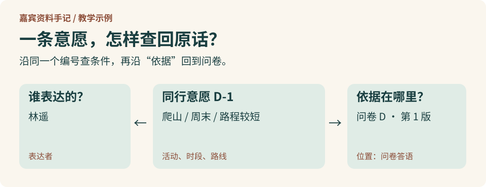

# 延伸阅读：怎样把一次查询用到的证据记下来？

假设你已经找到了林遥的问卷。下次再有人问谁周末想结伴爬山，又不想走太远，还要重新读一遍吗？

## 什么时候用检索就够了？

陈澈在自我介绍里写道：“我每周六都会去爬山，一个人走也挺好。”如果你只想知道她周六常做什么，读一句原文就能答。资料多了，可以先检索，再让语言模型依据取回的原文回答，这叫**检索增强生成（RAG）**。如果找到的自我介绍只提到另填过一份问卷，还可以让 **Agent（智能体）** 调用工具继续查。为它提供工具、文件和进度记录的运行环境常称为 **Harness**。[Agent 开发说明](https://www.anthropic.com/engineering/building-effective-agents) · [长期任务中的 Harness 设计](https://www.anthropic.com/engineering/effective-harnesses-for-long-running-agents)

第一章用同样的四份材料比较三种查法：直接找相关原文，根据已经找到的线索再查一轮，以及沿人物和资料之间的关系查找。[RAG 原始论文](https://arxiv.org/abs/2005.11401) · [SAG2 原始论文](https://arxiv.org/abs/2610.22588) · [GraphRAG 原始论文](https://arxiv.org/abs/2404.16130)

## 怎样用三元组记下林遥的愿望？

林遥在问卷里写道：“我刚开始爬山，周末想找个伴一起去，路别太长就好。”如果只写“林遥喜欢爬山”，就丢掉了你最关心的那层意思。我们给这次表述取个编号 D-1，试着把“谁表达了什么期待”拆开记。表中每一行都是一条**三元组**：主语是说哪条记录，谓语是要说明的关系，宾语是关系指向的对象或值。[W3C 的 RDF 入门说明](https://www.w3.org/TR/rdf11-primer/#section-triple)

| 主语 | 谓语 | 宾语 |
| --- | --- | --- |
| D-1 | 属于类型 | 同行意愿 |
| D-1 | 表达者 | 林遥 |
| D-1 | 希望一起做的活动 | 爬山 |
| D-1 | 希望的时段 | 周末 |
| D-1 | 路线偏好 | 路程较短 |
| D-1 | 依据 | 问卷 D 第 1 版的答语 |

“同行意愿”是本体里定义的一类事物，D-1 是一个实例。试着按“希望一起爬山”查询，看看该不该把陈澈也列进来。再把问题改成“已经约好哪天见面”，表里有这样的关系吗？没有查到约定，只说明手里的资料不足以回答。

## 哪些工作值得长期做？

如果你正在学计算机工程，可以把上表抄下来，去掉“属于类型”一行，再加入一条独自爬山的记录。只按活动查会多出谁？如果你负责企业知识库，可以请同事从查询结果找回原句，再试着更正一份问卷，看看哪些答案也要更新。

如果你负责系统设计，可以先拿十个经常被问到的问题做比较：直接查文档要多久，整理成记录后核对一次又要多久？别漏算第一次建模和每次改资料的时间。一个人偶尔看三份自我介绍，直接读就够了；如果同一条意愿会用在资料问答、清单和后续更正中，保留一条带出处的记录就更有价值。将来若把“周末”拆成周六和周日，旧问卷没有细说，迁移时也得允许保留“周末”。
