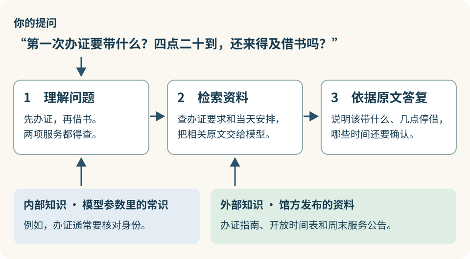

# 1.1 借书场景：第一次去浙江图书馆

第零章的例子里，图书馆周日五点闭馆。按馆方的周末服务公告，11 月 15 日那天，在之江馆区借书得赶在下午四点半以前。这一节，我们接着用这个例子，看看你出门前问一句“还来得及借书吗”，Agent 会怎样帮你查。

## 出门前，你想问什么？

假设你以前没在浙江图书馆办过读者证。这次去之江馆区，你想当天办好证，借一本书带回家。算了一下路程，你下午四点二十才能到。出门前，你问 Agent：

> 我想在 11 月 15 日（周日）去浙江图书馆之江馆区办张成人读者证。第一次办，要带什么？我下午四点二十到，还来得及办好证、借本书吗？

要回答前一句，得查成人首次办证要带哪些材料。后一句多了一层：你得先办证，再借书。所以除了查借阅柜台几点停止受理，还得查你到馆时能不能办证。

## Agent 拿到你的问题之后会怎么做？

以这次借书为例，Agent 可以分三步帮你查清楚。

1. **弄清楚你想办什么事。** 你问“四点二十到还来得及吗”，是想知道能不能在当天办好证、把书借走。Agent 借助语言模型理解这层意思，再确定要查哪些事：成人第一次办证要带什么，11 月 15 日之江馆区的办证和借阅柜台分别几点停止受理。
2. **查找相关资料。** Agent 根据这些问题调用检索工具，到馆方网站查成人首次办证的指南，再查周末服务公告，核对那天的柜台安排。检索工具把找到的原文交给语言模型。
3. **根据原文答复你。** 语言模型结合你的提问和查到的资料，先说要带什么，再说明四点二十到馆能否办完这两件事。资料里要是只写了借阅的截止时间，答复里就要说明办证时间还需确认。

这里用到的**检索增强生成（RAG）**，就是先从外部资料中查找与提问有关的内容，再让语言模型依据查到的内容作答。

为什么还要查资料？语言模型在训练中学到的知识体现在参数里，这是模型的**内部知识**。其中有些可以理解为常识。比如，模型知道办证通常需要核对身份，这能帮它想到要查证件要求。可单凭这条常识，推不出之江馆区接受哪种证件，也推不出某个周日的柜台安排。

馆方把办证要求写在指南里，临时调整则可能另发公告。这些供 Agent 查询的资料属于**外部知识**。即使模型在训练时见过旧指南，馆方后来发布的新规定也不会自动写进模型参数。通过检索，模型可以在这次回答中用上适用于当天的规定。

本章后面会用同一个借书问题试几种查法。基础 RAG 根据提问找相关段落，SAG2 可以顺着段落里提到的线索接着查，GraphRAG 则利用馆区、服务和公告之间的关系找资料。等查到了资料，我们再回头看：凭这些原文，你能确定该带什么、四点二十到还来不来得及吗？

[下一节：Agent 怎样查资料、回答借书问题？](1-2-source-materials.md)
