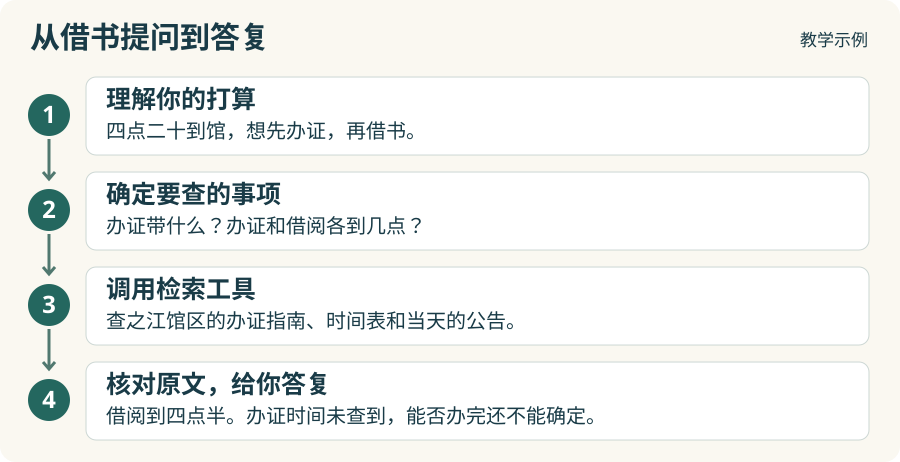

# 1.2 Agent 怎样查资料、回答你的问题？

“我下午四点二十到，还来得及借书吗？”如果你已经有读者证，查到借阅柜台的服务时间，就有了判断的依据。可你这趟还要先办证。接到这样的提问，Agent 怎样知道该查哪些资料？我们从你的出门计划说起。

## Agent 接到请求后做哪几件事？

1. **理解你的打算。** 你准备在 11 月 15 日去之江馆区，办好成人读者证再借书。下午四点二十是你预计到馆的时间。要判断是否来得及，得把办证和借阅按先后次序考虑。
2. **确定要查的事项。** Agent 把提问拆成三项：成人首次办证需要什么材料，当天几点停止办证，借阅柜台又在几点停止受理。这样，搜到闭馆时间时，它还知道哪些问题有待查证。
3. **调用检索工具。** 这三项都涉及馆方的具体规定。Agent 把馆区、日期和办理事项写进查询，请工具到馆务资料库里找指南、时间表和公告。
4. **核对原文，给你答复。** 工具返回资料后，Agent 要逐项核对：指南里的条款适用于谁？公告里的时间指哪项服务？能确认的就据实答复，资料没写的也要说清楚。

## RAG 怎样从资料库里找到依据？

到了第三步，Agent 已经知道要查哪些事。假设它能检索的馆务资料库里有下面四份材料。图中保留了标题、条款和时间，你可以用这些教学示例核对它找到的答案。

先看办证材料。Agent 用“之江馆区 成人首次办证”去查，馆区名和办理事项都能在指南 D 里找到。检索工具取回指南 D，模型就可以在“成人首次办证”条款里核对证件要求。查借阅时间时，Agent 可以用“之江馆区 11 月 15 日 借阅柜台”找到公告 C。即使先找到的是主页 A，也还有线索：主页提到了《周末服务公告》，可以用这个名字接着查。

馆区名和公告名适合按词查找。有时你的说法和馆方的措辞有些距离。你说“借本书带走”，公告里写的是“受理借阅”。系统也可以用**向量检索**，找出用词不同、意思相近的文档。

找到相关文档之后，还要看它能回答哪一问。你可以先看时间表 B，再看公告 C：B 里的 17:00 是周日闭馆的时间，C 里的 16:30 才是 11 月 15 日停止借阅的时间。再翻到指南 D，它写明了办证要带的材料，却没写办证柜台几点停止受理。语言模型把这些原文和你的提问对照起来，就可以给出这样的答复：

> 第一次办读者证，请带本人有效身份证件原件。11 月 15 日，之江馆区的借阅柜台下午四点半停止受理。你四点二十到，离停止借阅只剩十分钟。现有资料没写当天几点停止办证，也没说办证要花多久，所以还不能确定你能否在这十分钟里办好证、借到书。

要做刚才这样的查询，得先把馆方发布的主页、时间表、公告和指南整理入库。下一节，我们就来准备这四份文档，看看怎样保留表头、条款和出处，让 Agent 查到资料后还能回到原件核对。

[下一节：原始资料怎样整理入库？](1-3-document-preprocessing.md)
