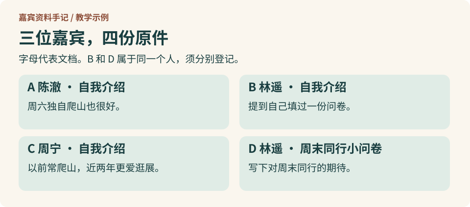
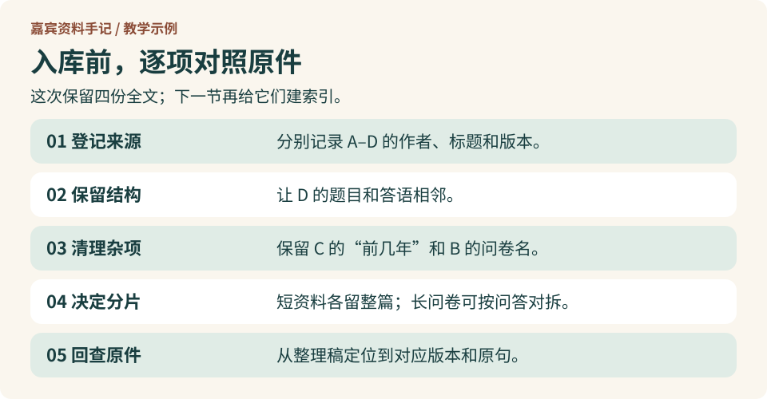

# 1.3 原始资料怎样整理入库？

刚才的回答引用了问卷 D。现在从另一头做一次：假设你负责准备资料，下次有人问起谁想在周末结伴爬山，你怎样让他既能找到林遥的原话，又能看出她当时回答的是哪道题？

三份自我介绍见[第 1.1 节的嘉宾资料图](1-1-weekend-companion.md)，林遥的问卷答语见[第 1.2 节](1-2-source-materials.md)。

## 第一步：收集原件，登记来源

把 A 到 D 各保存一份，在清单里记下文档编号、嘉宾、标题和版本。三位嘉宾有四份文档：B 和 D 的作者都是林遥，但一份是自我介绍，一份是问卷。用姓名当文件名，第二份就可能盖掉第一份。

## 第二步：读出文字，保留结构

打开 D。标题告诉你是谁填的，问题写着“你希望怎样和对方度过周末？”，下面才是答语。把标题、问题和答语按顺序保留下来。只抄“路别太长就好”，就看不出她说的是周末和同伴一起爬山的路。

## 第三步：清理无关内容

如果从网页复制时带进来“返回首页”这样的菜单，可以从整理稿删掉。再读 C，试着遮住“前几年”，看看意思变了没有。这三个字和“这两年”都要保留。B 提到的问卷名也要留下，下一轮检索可能就靠它。

## 第四步：按需分片，标明出处

四份资料都很短，这次**每份整篇作为一个检索单元**。以后遇到十几道题的长问卷，可以考虑按问答对拆分。每一段仍要能定位到嘉宾、原问卷的版本和题目。不要把问题切在一段、答案切在另一段。

## 第五步：对照原件，保存入库

打开整理后的 D，从答语找到原件对应的题目；再查 C，确认周宁说的是过去常爬山。最后从 B 里的标题找到 D。三个检查都通过，就把四份整理稿和来源清单一起保存。此时你有了建索引的材料，还没有运行检索。

[下一节：1.4 基础 RAG 的检索实验：召回与重排](1-4-basic-rag.md)
