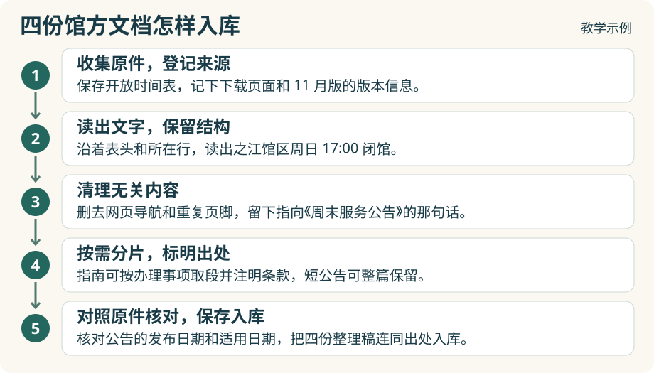

# 1.3 原始资料怎样整理入库？

上一节用到了四份馆方资料。这一节，我们回到收到原件的那一刻：怎样把网页、时间表、公告和指南整理成资料库里的四份文档？下面用同一批教学示例走一遍**文档预处理**的过程。

## 我们现在手上已有的 4 份文档

## 把四份文档整理入库

### 第一步　收集原件，登记来源

先给四份材料留一份原样的副本。网页可以保存页面快照，下载的时间表和指南可以保留原文件。再做一份简单的来源清单，每份原件占一行，写下标题、发布者、取得文件的地址，以及原件上标明的版本或发布日期。

例如，B 这一行记为“《各馆开放时间表》，11 月版，第 1 页”。即便时间表是从电脑里找到的，仍要注明它来自哪个馆方页面。如果手头的副本没有标明版本，就把版本留作待核实。下载文件的那一天只能说明你何时拿到了它。

### 第二步　读出文字，保留结构

把原件里的内容读成程序能处理的文本，这一步叫**解析**。网页可以按标题、小标题和正文的顺序读取；表格要连同表头和各行一起读取。遇到扫描件，可以先用文字识别工具读出文字，把扫描原件留到第五步核对。

拿时间表 B 试试。读完以后，找到“17:00”，沿着同一行应该能看到“之江馆区”，沿着表头应该能看出这里写的是周日闭馆时间。再看指南 D，“成人首次办证”这个小标题应该仍在证件要求的上方。能保住这些位置关系，整理后的文档才读得懂。

### 第三步　清理无关内容

打开解析后的馆区主页 A。假如正文前面混进一排导航菜单，结尾又重复了页脚，可以在这一份文本里删去这些内容。复制网页时产生的多余空行也可以合并。做完后再读一遍“周末到馆”这一段，看原来的两句话是否完整。

尤其要留下“各柜台的办理时间请查《周末服务公告》”。如果网页上这句话带有链接，就把公告名和链接一起保存。它是馆方指给你的查阅路径，和页面顶部的通用导航用途不同。

### 第四步　按需分片，标明出处

**分片**是为检索决定一次取回多少文字。拿指南 D 来说，如果准备按办理事项查找，可以把“成人首次办证”这个小标题和下面的证件要求存成一个检索片段，并记下出处是《之江馆区办证指南》11 月版的“成人首次办证”条。以后只取回这一段，也能看出这项要求适用于谁。

这次练习的四份材料都很短，可以各用整篇作为一个检索单元。比如公告 C 全文放在一起，日期、馆区和停止借阅的时间就能一起查到。无论取整篇还是按条款取，资料清单里始终是 A 到 D 四份原件。

### 第五步　对照原件核对，保存入库

把整理稿和原件并排打开。先看公告 C：11 月 12 日是发布日期，11 月 15 日才是借阅柜台于 16:30 停止受理的日子。再看时间表 B，两个馆区的闭馆时间有没有串行？指南 D 的“本人有效身份证件原件”有没有漏掉“原件”两个字？发现出入，就按原件更正。

核对完，把四份整理稿收入资料目录，在来源清单里添上对应的文件名。如果为长文保留了检索片段，也要确认能从片段找到所属文档和原文位置。下一节，我们就用这四份准备好的文档建立索引，把最初的借书问题交给 RAG 检索。

[下一节大纲：1.4 基础 RAG 的检索实验：召回与重排](1-4-basic-rag.md)
