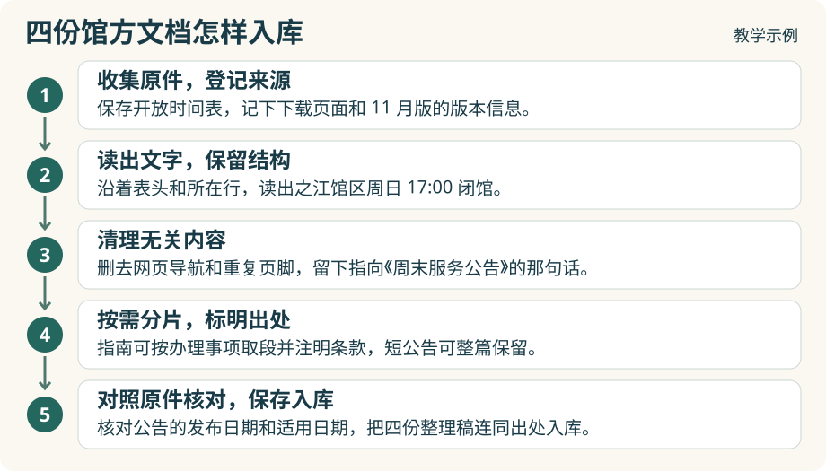

# 1.3 原始资料怎样整理入库？

上一节，Agent 从办证指南里查到一句话：“请携带本人有效身份证件原件至服务台办理。”如果你只看到这一句，能判断它说的是第一次办证，还是补办证件吗？往上看一行，指南里的小标题写着“成人首次办证”。下次有人问第一次办证要带什么，检索工具最好能把这两行一起找回来。

馆方发布的是整份指南，查询时用到的却可能只是其中一条规定。系统收录或更新文档时，需要先做**预处理**，把原件整理成可以单独查找的片段，同时记下每段的出处。我们就用[上一节的四份模拟原件](1-2-source-materials.md)做一次。

## 从原件到片段，分五步整理

1. **收集原件，登记来源。** 先保存馆区主页 A、开放时间表 B、周末公告 C 和办证指南 D。拿时间表来说，如果它是你以前从官网下载的，除了文件本身，还要记下下载页面和表上标明的版本。以后馆方换了时间表，你仍然知道当时查的是哪一份。

2. **解析文件，读出文字和结构。** 解析网页时，要能分出页面标题、小标题和正文。解析表格时，要看得出每个值属于哪一行、哪一列。时间表 B 里有两个时间，沿着馆区名称和表头读，才能确定 17:00 是之江馆区周日的闭馆时间，18:00 属于曙光路馆区。碰到扫描件，还需要先识别图上的文字。

3. **清洗内容。** 假设从馆区主页 A 读出的文字里混进了导航菜单和重复页脚，整理正文时可以把它们去掉。有一句话要留下：“各柜台的办理时间请查《周末服务公告》。”虽然这句话没有给出时间，却能指引 Agent 找到公告 C。原件也要保留，遇到断行或辨认不清的数字，才有地方核对。

4. **按内容分片。** 想一想，系统每次搜到多长的一段，才够你读懂一条规定？指南 D 可以按办理事项切分，让小标题跟着条款走。公告 C 只有一小段，整段保存就好。要是只截取“16:30 停止受理”这几个字，正好会丢掉前面的适用日期、馆区和柜台名称。[片段上下文的工程实验](https://www.anthropic.com/research/contextual-retrieval)

5. **给片段编号，记下出处。** 把公告这一段编为 C-1，再记下它来自《周末服务公告》11 月 12 日发布版的第 1 段。编号、版本和原文位置都属于**元数据**。如果还要按日期筛选服务安排，可以另记一个“适用日期”，填入正文里的 11 月 15 日。这样查询当天的借阅安排时，就不会把发布日期当成服务调整的日子。

## 四份原件整理出了什么？

下面五个片段就是下一节检索实验要用的材料。时间表 B 按馆区拆成了两段。每一段都带上了馆区名和服务项目，单独取出一行也能看懂。

| 编号 | 供检索的文字 | 回到原件的哪里核对 |
| --- | --- | --- |
| A-1 | 之江馆区 · 周末到馆。本馆周日开放。各柜台的办理时间请查《周末服务公告》。 | 之江馆区主页，“周末到馆”段 |
| B-1 | 之江馆区，场馆开放，周日 17:00 闭馆。 | 《各馆开放时间表》11 月版，第 1 页之江馆区行 |
| B-2 | 曙光路馆区，场馆开放，周日 18:00 闭馆。 | 同一时间表，第 1 页曙光路馆区行 |
| C-1 | 11 月 15 日，之江馆区借阅柜台于 16:30 停止受理借阅，当天闭馆时间照常。 | 《周末服务公告》11 月 12 日发布版，第 1 段 |
| D-1 | 之江馆区 · 成人首次办证。请携带本人有效身份证件原件至服务台办理。 | 《之江馆区办证指南》11 月版，“成人首次办证”条 |

拿 D-1 做个检查。先盖住出处一列，只看中间的文字：你能说出这条证件要求适用于谁、要办什么事吗？再看右边的出处，翻回指南，核对“原件”两个字。第一步检查片段离开整份文档后还能不能读懂，第二步检查别人能不能凭它找到原话。

以后做本体建模，这批材料还用得上。比如，要把 C-1 整理成知识库里的一条服务安排，可以从中提取馆区、服务、日期和截止时间。遇到“16:30 到底是闭馆还是停止借阅”这样的疑问，仍能凭 C-1 的出处回到公告核对。

## 下一节 · 基础 RAG 的检索实验：召回与重排

你看过这五个片段，知道第一次办证要带什么得查指南 D-1，当天几点停止借书得查公告 C-1。可你出门前问的只是“四点二十到，还来得及办证、借书吗？”系统能从这句话找到那两段原文吗？

到了 1.4，我们会给这五个片段建好索引，用 1.1 的同一个借书问题分别试一遍关键词检索、向量检索和混合检索。先看看每种查法找回了哪些候选片段，这一步叫**召回**。再把候选片段逐一和提问对照，按相关程度重新排序，看看哪些会排在前面、交给模型，这一步叫**重排**。

试验时可以盯住公告 C-1：如果它排在开放时间表 B-1 后面，重排有机会把它往前移。如果第一步就没找到 C-1，再怎么调整已有片段的顺序，模型也看不到公告里的借阅截止时间。

[下一节大纲：1.4 基础 RAG 的检索实验：召回与重排](1-4-basic-rag.md)
