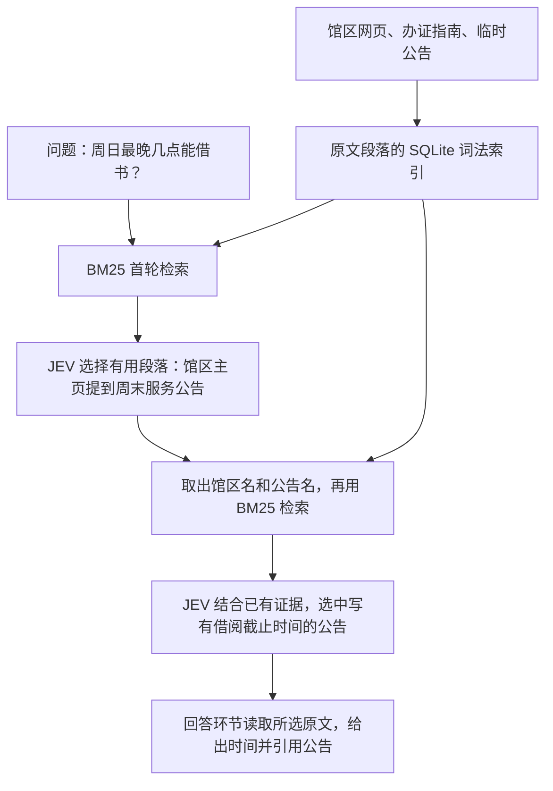

# 本体论入门指南 · 逐节教学大纲

这是一份运用本体建模方法的知识工程教程。我从查资料时遇到的一个疑问出发：找到相关段落之后，怎样判断它究竟支持哪条结论？第一章用浙江图书馆的日常问题演示 Agent 检索。第二章起用企业档案案例检验检索与建模各环节。每节一篇，阅读和短思考预算约十分钟；实验另计。每篇正文安排核心概念、范例、思考、Q&A 和 References。本稿列到章节与小节，以下资料为各章备课入口。

## 第 0 章 · 课程说明

介绍 AI、Agent 与 Harness 怎样让知识工作走向自动化，用一次借书问答与一次公告更新，对照检索和建模各自解决的问题，说明为什么构建本体、怎样按实际查询与更新频次衡量建模维护成本、数据复用和纠错收益，再说明从问题、证据和模型走到知识库验收的学习路线。

用同一条服务安排练习把主语、谓语、宾语读成一句话，再沿图中的关系回查原文。

[阅读课程说明](../00-course-overview/0-course-overview.md)

## 第 1 章 · 外部知识的组织与检索方法概览（7 节）

**对应目录**　[01-how-existing-systems-organize-knowledge/](../01-how-existing-systems-organize-knowledge/)

**核心问题**　手上有一批文档，用户提了一个需要查资料的问题。Agent 可以调用哪些检索技术？这些技术分别怎样从文档中找到证据，Agent 又怎样据此作答？

**贯穿案例**　“我第一次去之江馆区办证，11 月 15 日下午四点二十到，要带什么？还来得及借书吗？”馆区、日期和到馆时间都已给定。三种方法使用同一批模拟馆方资料：馆区主页、各馆开放时间表、周末服务公告和办证指南。时间表给出闭馆时间，主页介绍周末到馆事项，并指向另行公布的借阅柜台安排。读者需要分别核实借阅截止时间和办证材料。

**阅读顺序**　明确借书场景 → 跟随一次借书查询 → 回看资料入库过程 → 任选一种检索技术获取证据 → 核对证据并收尾。1.4 至 1.6 是对同一问题的三次独立推演。

### 1.1 借书场景：第一次去浙江图书馆

从第一次去之江馆区的成年读者出发，明确日期、馆区、办证和借阅两项服务，以及读者需要据此做出的出行决定。

[阅读 1.1 正文](../01-how-existing-systems-organize-knowledge/1-1-borrowing-scenario.md)

### 1.2 Agent 怎样查资料、回答借书问题？

先从 Agent 的角度讲清理解请求、确定查询事项、调用工具和核对答复，再展示 RAG 如何从模拟馆务资料里找回原文，回答出门前的问题。

[阅读 1.2 正文](../01-how-existing-systems-organize-knowledge/1-2-source-materials.md)

### 1.3 原始资料怎样整理入库？

[阅读 1.3 正文](../01-how-existing-systems-organize-knowledge/1-3-document-preprocessing.md)

用四份模拟原件练习登记来源、解析文件、清洗内容、按需分片并标明出处、核对原件并入库。整理好的四份文档供 1.4 建索引和检索。

### 1.4 基础 RAG 的检索实验：召回与重排

[查看本节大纲](../01-how-existing-systems-organize-knowledge/1-4-basic-rag.md)

用 1.3 的四份文档建立索引，再用同一个借书问题比较关键词检索、向量检索与混合检索返回的文档，再观察重排怎样影响最终交给模型的材料。若公告在最初的候选里就已遗漏，重排也无法补回它。[DrQA](https://arxiv.org/abs/1704.00051) · [DPR](https://arxiv.org/abs/2004.04906) · [RAG 原始论文](https://arxiv.org/abs/2005.11401) · [混合检索与排名融合](https://learn.microsoft.com/en-us/azure/search/hybrid-search-ranking)

### 1.5 SAG2：用已找到的证据引出下一轮检索

[查看本节大纲](../01-how-existing-systems-organize-knowledge/1-5-sag2.md)

本节采用 SAG 系列中使用 JEV 的 SAG2。它为原文段落建立 SQLite 词法索引。查询时先由 BM25 召回候选，再由 JEV 结合问题和已有证据选择有用段落；选中段落中的词可以驱动下一轮搜索。假设首轮只找到馆区主页，学员要指出“周末服务公告”这条新线索来自哪句话，以及第二轮找到的公告补足了什么。办证材料沿同样方式核对，所选原文交给回答环节。[SAG2 原始论文](https://arxiv.org/abs/2610.22588) · [项目方技术说明](https://zleap.ai/en/technology/sag2)

**图 1　SAG2 如何找到分散在两份资料中的时间信息（教学示意）**

### 1.6 GraphRAG：沿实体关系寻找材料，跨文档汇总信息

[查看本节大纲](../01-how-existing-systems-organize-knowledge/1-6-graphrag.md)

以微软 GraphRAG 为例，说明建索引时如何从文本中抽取馆区、服务和公告等实体及其关系，并为图中联系紧密的实体群生成摘要。回到同一个借书问题，从指定馆区出发，沿“馆区—借阅服务—适用公告”找到关联材料，再读取原文核实时间和办证条件。随后只改变问题的范围，追问“各馆区周末借阅有哪些共同限制”，演示全局查询怎样汇总多个社群的摘要。让学员分别指出单馆答案的原文依据和跨馆概括的覆盖范围。[GraphRAG 原始论文](https://arxiv.org/abs/2404.16130) · [项目文档：局部查询](https://microsoft.github.io/graphrag/query/local_search/)

### 1.7 答案生成与评估

[查看本节大纲](../01-how-existing-systems-organize-knowledge/1-7-answer-evaluation.md)

**答案生成（正文要点）**　把各方法取回的证据放在同一张表里，每个子问题占一行，记录适用馆区、日期、原文位置和原文支持的结论。若公告与指南分别给出了截止时间和所需材料，Agent 即可逐项回答并附出处。若主页只提到另有周末公告，就沿这条线索补检。若可查资料已经读完，仍只知道闭馆时间，则先回答已确认的办证材料，并明确借阅柜台的截止时间有待确认。

**评估（正文要点与章末练习）**　先由学员依据原文写出两个子问题的参考答案，标明各自需要的证据。用同一份资料对照三种方法的查询记录，逐项核对：所需证据是否被召回并进入模型上下文？答案是否正确且答全？每项结论所引的原文是否足以支持它？例如，系统可能碰巧答对截止时间，却引用了一条只写闭馆时间的记录，此时答案正确性与引用质量应分别记录。最后加入一份只对指定周日生效的临时公告，更新索引后复测。带着最早出错的环节进入第二章。[ALCE 引用评估](https://arxiv.org/abs/2305.14627) · [Ragas 分阶段评估](https://arxiv.org/abs/2309.15217)

## 第 2 章 · 从检索到作答的常见错误与成因（4 节）

**对应目录**　[02-problems-in-search-and-agent-knowledge-bases/](../02-problems-in-search-and-agent-knowledge-bases/)

**回应的问题**　面对同一份档案，人工搜索和调用外部知识库的 Agent 为什么会给出遗漏、误收或已经过时的导演名单？

**主要问题**　错误最早出现在哪里？依次检查资料是否齐全、检索是否命中、知识库是否同步更正，以及 Agent 的结论是否得到所引材料的支持。

1. **2.1 漏掉了哪部作品**　固定资料快照和可见范围，对照人工清单记录漏项。
2. **2.2 多收了哪部作品**　比较拟邀与发行署名，区分召回阶段的误收和最终答案的误判。
3. **2.3 谁有资格证明这件事**　按问题区分提案、片尾与更正记录，检查版本、权限和引用位置。沿着 Agent 引用的人物页回查原件，核对更正是否已经同步到页面。
4. **2.4 检索索引组织了什么，还缺哪一层知识？**　对照片段索引和发行署名表：两者都能保存结构，但片段相关度无法单独表达“谁在何版本以何种角色参与”。标出可由索引补录、检索调优、领域建模或来源审核分别处理的问题。

**核心范例与交付**　一张失败样例表。对同一资料快照，分别记录人工搜索和 Agent 调用的来源、命中记录、最终答案及最先出错的环节。

**思考**　引用一字不差，结论为什么仍可能错？

**Q&A**　问：哪个来源最权威？ 答：先指定要证明的陈述。提案能证明拟邀，发行版署名应回到相应版本的片尾。

**References**　[Azure Databricks 的 RAG 质量评估思路](https://learn.microsoft.com/en-us/azure/databricks/agents/tutorials/ai-cookbook/quality-rag-chain) · [GSA 数据溯源与证据追踪指南](https://github.com/hansenz42/guides_4_AIagents/blob/206bfbe/translate/zh-CN/guide_KG_DataProvenanceEvidenceTracking.md)

## 第 3 章 · 知识工程导论（4 节）

**对应目录**　[03-introduction-to-knowledge-engineering/](../03-introduction-to-knowledge-engineering/)

**回应的问题**　要让不同部门反复回答“林青执导过哪些已发行作品”，需要对人物、作品版本、角色和证据作出哪些共同约定？

**主要问题**　怎样识别同一个对象？怎样表达拟邀与正式署名？哪些错误可通过建模解决，哪些仍需补录证据？维护这些约定需要谁参与？

1. **3.1 怎样判断还是同一个对象**　以改名、转码和重剪为例，分别说明人物、文件与作品版本在什么条件下保持身份。
2. **3.2 什么是领域本体**　从人物、参与活动与角色中提炼概念和关系。用两条署名说明，团队如何把对领域的共同理解写成可检验的约定。
3. **3.3 用最小模型重答业务问题**　用作品、发行版本、角色与证据卡片重答导演清单，逐项回看第 2 章记录的漏项和误项，标出哪些还需补录资料或审核来源。
4. **3.4 什么时候值得投入知识工程**　比较一次性定位文件与多个部门反复查询署名两种需求。结合资料覆盖、领域专家和维护责任，写出采用或暂缓建模的理由。

**核心范例与交付**　一份人工推演结果和一份适用性判断，注明模型能解决的问题、所需前提与仍缺的证据。

**思考**　如果片尾可以直接回答编辑这一次提问，还有什么重复出现的业务需求值得维护一套模型？

**Q&A**　问：建立本体后就能确认资料缺失的署名吗？ 答：身份和角色的定义能帮助判断已有材料支持什么；缺少发行证据时，结论应保留为待核实。

**References**　[Keet《An Introduction to Ontology Engineering》](https://people.cs.uct.ac.za/~mkeet/files/OEbook.pdf) · [GSA 模式设计指南](https://github.com/hansenz42/guides_4_AIagents/blob/206bfbe/translate/zh-CN/guide_KG_SchemaDesign.md) · [GSA 从能力问题到本体](https://github.com/hansenz42/guides_4_AIagents/blob/206bfbe/translate/zh-CN/guide_ontology_CQ2Onto.md)

## 第 4 章 · 工程第一步：能力问题（CQ）（3 节）

1. **4.1 从用例写 CQ**　让编目员和编辑各带一条实际署名，分别解释“执导过”是否包含拟邀或联合执导。将分歧写成两组预期答案。若双方问的是不同问题，拆成“曾拟邀哪些人”和“发行版由谁执导”两个 CQ；若对同一问题的口径仍有争议，由业务负责人记录采用理由或标为未决。
2. **4.2 给正例、反例和未知写参考答案**　明确什么证据足以收录，什么情况要暂缓。
3. **4.3 把能力问题变成验收表**　整理十题，指定输入快照、预期结果和验收人。

**核心范例与交付**　一组可复测的 CQ，从这里开始保留回归样例。

**思考**　查到零条与确认没有，在验收表里分别怎么写？

**Q&A**　问：所有 CQ 都能靠数据库查询验收吗？ 答：部分需人工检查证据或权限；在验收表里分别注明。

**References**　[GSA 能力问题指南](https://github.com/hansenz42/guides_4_AIagents/blob/206bfbe/translate/zh-CN/guide_ontology_CompetancyQuestions.md) · [LOT 需求规格模板与资源](https://github.com/oeg-upm/LOT-resources)

### 贯穿练习 · 给十道 CQ 写下可以核对的答案

先读[导论中的三条原始材料](../docs/00-企业RAG与本体.md)。以下作品和署名均为虚构教学样例。起始快照包含《河流来信》发行版片尾 24:10、《城市回声》提案第 2 页及其发行版片尾 46:20。前三题只用这份快照。后续各题单独添加表中所述的材料，以便定位答案变化的原因。它们都是公开给读者的练习；第 12 章另选原件做独立验收。

| 题号 | 业务问题与给定条件 | 预期答案与判定依据 |
| --- | --- | --- |
| CQ-01 | 林青在哪些作品的发行版署名为导演？ | 集合恰含《河流来信》，依据片尾 24:10。《城市回声》中的拟邀记录不能使它入选。 |
| CQ-02 | 哪部作品有拟邀林青执导的材料？ | 《城市回声》，依据提案第 2 页。问的是曾有此意向，毋须推断是否实际执导。 |
| CQ-03 | 《城市回声》的发行片尾分别怎样署名？ | 周明任导演，林青任访谈嘉宾，两项均可定位至片尾 46:20。 |
| CQ-04 | 给《河流来信》同一发行版增加一个转码文件，作品、发行版与文件各有几个？ | 原有一个文件时，更新后为一部作品、一个发行版、两个文件。 |
| CQ-05 | 另一份名录也写“林青”，只有姓名能否认定是同一人？ | 身份待核实。保留来源记录，人物清单不能因为同名自动合并。 |
| CQ-06 | 新增只有拟邀提案的《山城夜话》，能否列入已确认的导演清单？ | 暂不收录，注明缺发行署名；关于实际导演的答案为未知。 |
| CQ-07 | 两份同等权威的发行记录给出不同日期，尚无裁决，正式业务表返回什么？ | 日期未决，可查看两个日期及各自依据。任取其中一个都算误答。 |
| CQ-08 | 同一发行版的勘误于 6 月入库，将原署名从甲改为乙；5 月系统已采纳甲。两个时间点怎样查？ | 按 5 月当时所知返回甲；按今天掌握的证据回看该版本返回乙，二者分别引用当时有效的记录。 |
| CQ-09 | 某条署名及其唯一证据只向编目员开放，普通员工询问时能看到什么？ | 编目员可见署名和引用；普通员工得到限定在其可见资料范围内的回答，输出不透露受限署名或片段。 |
| CQ-10 | 撤回支撑某项正式署名的唯一证据后，哪些结果需要复核？ | 沿派生关系定位该署名，以及使用它的检索条目和 Wiki 页面。复核前，当前清单停止将它列作已确认；历史审核决定可追查。 |

**怎样把 CQ-01 交给后续章节。** 第 5 章先在纸上画出“人物 ← 参与记录 → 发行版本 → 作品”，给参与记录填上角色。第 7 章把两份片尾中的署名和提案中的拟邀记录分别审核。第 8 章从已审核的发行署名中筛选林青和导演角色，返回作品标识、片名与证据位置。如果去掉角色条件后《城市回声》仍未出现，就回查嘉宾署名是否在入库时丢失；如果加回条件后它仍在清单中，就检查查询连接和角色映射。用这一题把“答错了”定位到具体环节。

## 第 5 章 · 从 CQ 建模，并与已有模型整合（7 节）

1. **5.1 从问题提取建模需求**　给“谁以什么角色参与哪个版本”标出待区分的概念。为“发行版本”写一张定义卡：判定条件、正例、边界反例及关联 CQ；请另一位编目员独立分类并解释分歧。
2. **5.2 身份与标识**　区分同名人物、作品、版本和文件，制定合并条件。
3. **5.3 关系何时需要单独记录**　把角色、版本与证据附到一次参与上。
4. **5.4 选择公理和约束**　用 OWL 子类推理展示可推导事实，区分缺少记录与已知否定。
5. **5.5 把模型写成 RDF**　用 IRI、三元组、字面量和 Turtle 表达两个实例，手算一次图匹配。
6. **5.6 知识库中哪些概念可以复用**　先查现有概念的标识、定义、实例和维护方。用一个正例和一个反例检验范围是否一致：定义一致时沿用标识，新 CQ 缺少的版本级署名单独建模，保存新旧关系映射。
7. **5.7 新旧模型定义冲突怎么办**　旧库的“作者”包括撰稿人与导演，新模型要查发行版导演。用一条只有撰稿署名的记录检验直接合并会不会误收；分别记录可映射的条件、应保留的旧义和待裁决项。回放旧查询与新 CQ，检查原报表仍能解释，新清单也没有多出导演。

**核心范例与交付**　整合后的模型、概念复用与冲突裁决记录、旧新查询的预期答案。

**思考**　改成“人物—执导—作品”的直接关系会丢失哪个答案？

**Q&A**　问：CQ 能唯一确定模型吗？ 答：可以有多种模型；用反例、复用成本与 CQ 覆盖选择。

**References**　[GSA 模式设计与复用](https://github.com/hansenz42/guides_4_AIagents/blob/206bfbe/translate/zh-CN/guide_KG_SchemaDesign.md) · [GSA 从能力问题到本体](https://github.com/hansenz42/guides_4_AIagents/blob/206bfbe/translate/zh-CN/guide_ontology_CQ2Onto.md) · [W3C RDF 1.1 Primer](https://www.w3.org/TR/rdf11-primer/) · [W3C OWL 2 Primer](https://www.w3.org/TR/owl2-primer/)

## 第 6 章 · 权威记录与受控词表：SSOT 和 SKOS（3 节）

1. **6.1 按事实确定权威来源**　为发行日期和拟邀状态分别指定维护方、适用范围与冲突策略。
2. **6.2 用 SKOS 区分概念与标签**　给角色概念稳定标识，保留首选名称、别名和语言；用上位主题查找下位主题的作品，比较直接匹配与扩展查询的答案。
3. **6.3 跨部门词表如何对齐**　判断“策划”是岗位还是参与角色，决定精确映射、近似映射或暂缓。

**核心范例与交付**　一张权威记录责任表和一份 SKOS 角色词表。

**思考**　同一词能否指两个概念？同一概念能否由两个部门维护不同标签？

**Q&A**　问：确定首选标签就解决 SSOT 了吗？ 答：标签决定如何称呼概念；权威记录还需规定谁维护哪类事实，以及更正如何生效。

**References**　[W3C SKOS Primer](https://www.w3.org/TR/skos-primer/) · [GSA 数据溯源与证据追踪指南](https://github.com/hansenz42/guides_4_AIagents/blob/206bfbe/translate/zh-CN/guide_KG_DataProvenanceEvidenceTracking.md)

## 第 7 章 · 依据本体处理文档：从抽取、去重到正式记录（6 节）

1. **7.1 文档解析怎样改变一条陈述的含义**　用一张“拟邀人员”跨页表演示解析：第二页缺少表头时，把“拟邀”与人员行一同保留，并记录页码、版本和访问范围。比对丢失表头前后的抽取结果。
2. **7.2 从表格映射到候选事实**　保留行号，检查缺失字段。
3. **7.3 约束文档抽取**　要求 Agent 输出模型允许的关系、原句与待审原因，区分拟邀和署名。
4. **7.4 同名人物如何消歧**　对照身份线索，记录合并或暂缓的理由。
5. **7.5 新概念如何归并**　分流同义标签、已有概念的新实例和确需审核的模型变更。
6. **7.6 候选事实怎样成为正式记录**　给同一发行版放入两个冲突日期。审核员查原件后可接受、退回或保留未决，写下理由；将采纳结果写入供第 8 章查询的数据集，保留两条原始主张。

**核心范例与交付**　候选集、去重记录与第一批已审核事实；争议项可追到原件和审核决定。

**思考**　抽取结果很像，但证据不足以确认同一人，怎样保留两条记录？

**Q&A**　问：抽取遇到陌生角色可以直接加类吗？ 答：先保留原词，再查词表与现有模型，必要时提交变更。

**References**　[GSA 实体解析与去重指南](https://github.com/hansenz42/guides_4_AIagents/blob/206bfbe/translate/zh-CN/guide_KG_EntityResolutionDedup.md) · [GSA 数据溯源与证据追踪指南](https://github.com/hansenz42/guides_4_AIagents/blob/206bfbe/translate/zh-CN/guide_KG_DataProvenanceEvidenceTracking.md)

## 第 8 章 · 用 SPARQL 回答 CQ，接入已有查询流程（4 节）

1. **8.1 写第一条 SELECT**　查人物的一条参与记录，对照第 5 章的三元组。
2. **8.2 把多跳关系连成作品清单**　连接人物、角色、版本与作品，预测遗漏一个条件会多出什么。
3. **8.3 对照 CQ 排查零行与重复**　固定数据范围，对比缺事实、缺连接和过滤错误。
4. **8.4 把 SPARQL 接入现有检索与问答**　沿用原知识助手的查询入口：找原文时走文档检索，列作品时用查询模板筛选可见的正式署名，再按版本标识取片尾证据。对比接入前后的清单、引用和权限；图查询没有结果时保留未知，文档命中可供补查。

**核心范例与交付**　查询文件、十题中的可执行检查，以及从现有知识助手返回的一条有出处的答案。

**思考**　两部作品同名时，按片名去重会丢掉什么？

**Q&A**　问：查询零行能证明没有导演吗？ 答：只能说明当前数据与查询条件没有匹配项。

**References**　[Azure AI Search 的 RAG 说明](https://learn.microsoft.com/en-us/azure/search/retrieval-augmented-generation-overview) · [W3C SPARQL 1.1 查询语言](https://www.w3.org/TR/sparql11-query/) · [W3C RDF 1.1 Primer](https://www.w3.org/TR/rdf11-primer/)

## 第 9 章 · 用 PROV-O 追溯来源与更正（3 节）

1. **9.1 给陈述找到证据**　为检索结果保留片段标识，沿“片段—来源版本—页码或时间码”定位原件；再核对正式陈述引用的是否为同一证据。
2. **9.2 描述来源链**　用实体、活动、责任主体表达提案经哪次抽取和审核产生候选结论。用一条晚到的更正区分事实适用日期与系统获知日期，分别回答“今天如何看当时”和“当时系统知道什么”。
3. **9.3 来源更正后追受影响的答案**　查询派生关系，保留旧结论、决定及时间，再发起复核。

**核心范例与交付**　一条能从答案追到原文、也能从更正追到受影响事实的来源链。

**思考**　一个 URL 在原件被替换后还能证明什么？

**Q&A**　问：PROV-O 会自动选择权威版本吗？ 答：它描述来源与形成过程；采用哪条结论由第 6 章的业务规则和审核决定。

**References**　[W3C PROV-O](https://www.w3.org/TR/prov-o/) · [GSA 数据溯源与证据追踪指南](https://github.com/hansenz42/guides_4_AIagents/blob/206bfbe/translate/zh-CN/guide_KG_DataProvenanceEvidenceTracking.md)

## 第 10 章 · 验证、测试与程序调试（4 节）

1. **10.1 区分四种正确性**　分别检查语法、推理一致性、数据结构与事实证据。
2. **10.2 用 SHACL 制造一次失败**　给“以视频片尾为证据的正式署名”设置必填时间码规则。用缺时间码的片尾记录触发错误，再用标有页码的纸质材料检查规则的适用范围。
3. **10.3 调试一条错答**　沿抽取、身份匹配、图查询、原文引用逐步缩小故障范围。
4. **10.4 汇总回归测试**　用人工核对的小样本单独检查漏抽、误抽和误合并；复跑 CQ，并用两个权限不同的账号检查答案和引用是否泄露受限事实。

**核心范例与交付**　一份分层测试报告及可以复现的错误修复过程。

**思考**　通过校验但引用了另一部作品的片尾，哪种测试能发现？

**Q&A**　问：应从本章才开始测试吗？ 答：第 4 章已写预期，第 5 章已试实例，第 8 章已验证查询；本章将它们自动化并补上反例。

**References**　[W3C SHACL](https://www.w3.org/TR/shacl/) · [W3C OWL 2 Primer](https://www.w3.org/TR/owl2-primer/) · [W3C SPARQL 1.1 查询语言](https://www.w3.org/TR/sparql11-query/)

## 第 11 章 · 设计数据流，治理本体和事实的变更（3 节）

1. **11.1 把已跑通的步骤画成数据流**　标出原件、候选、审核与发布边界，演练重复导入、来源撤回与权限收回，核对正式数据、检索索引和已生成 Wiki 页中的受影响内容；重跑时保留人工裁决。
2. **11.2 谁能改变概念定义**　为新词、概念拆分、事实纠错设置不同责任人与审核记录。
3. **11.3 迁移、重建与回滚**　模拟导演角色拆分，记录受影响查询并复现旧版报表。

**核心范例与交付**　一张运行流程图、责任表和一次可回退的变更演练。

**思考**　重新抽取旧文档时，如何避免覆盖人工审核过的结论？

**Q&A**　问：需要等本章才设计数据流吗？ 答：第 1 章先画现有流程，第 7 章运行最小流程，本章定稿运行和治理规则。

**References**　[GSA 模式灵活性与演化指南](https://github.com/hansenz42/guides_4_AIagents/blob/206bfbe/translate/zh-CN/guide_SchemaFlexibilityandEvolution.md) · [Ontology Development Kit](https://github.com/INCATools/ontology-development-kit)

## 第 12 章 · 知识库第一版：交付与验收（3 节）

1. **12.1 用未参与建模的原件跑一次入库**　请业务同事封存一份从未用于建模或调试的原始节目资料，并独立标注预期的实体、关系、证据位置和未决项。固定本体、词表与抽取规则，从原件开始运行解析、抽取、消歧、审核和写入。对照中间结果及正式记录，标出误差最早出现的环节。参考标注仅用于评分。
2. **12.2 用查询验收入库结果**　复跑原有十道 CQ，再查询新入库的作品和署名；在相同资料与权限下对比原 RAG 和本体辅助回答。分别报告旧题回归、入库错误和最终答案质量。对清单题列出预期作品、实际作品、漏项和误项，再逐项核对引用；对未知题检查是否妄下结论。保存失败样例与审核用时。
3. **12.3 由另一位同事重建并接手**　交付模型、数据、查询、测试、来源与操作说明，演示一次资料更正。

**核心范例与交付**　可重建的知识库版本、留出原件的入库验收记录、问答评估与已知限制。

**思考**　哪条失败会阻止发布，哪条可以带着已知限制交付？

**Q&A**　问：怎样定义完成？ 答：约定范围的能力问题达到验收标准，证据可核验，责任人能复建并处理更正。

**References**　[LOT 需求规格模板与资源](https://github.com/oeg-upm/LOT-resources) · [Azure Databricks 的 RAG 质量评估思路](https://learn.microsoft.com/en-us/azure/databricks/agents/tutorials/ai-cookbook/quality-rag-chain)

[返回教程首页](../README.md) · [教学规划与资料清单](本体驱动的知识工程开源教程-教学大纲与资料清单.md)
